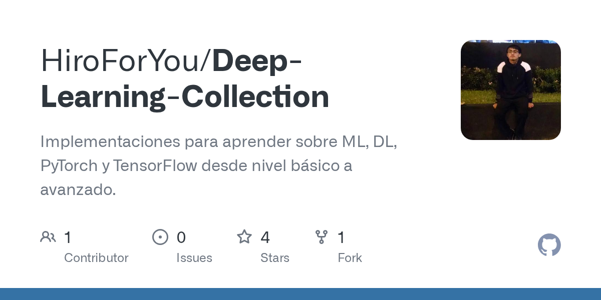

Cada vez que aprendía una arquitectura nueva, terminaba con el mismo desorden: un notebook copiado
de un video, un script adaptado a medias del repositorio de alguien más y un dataset que un mes
después ya no encontraba. Así que empecé a juntarlo todo en un solo lugar, ordenado y listo para
correr. Ese lugar es
[Deep-Learning-Collection](https://github.com/HiroForYou/Deep-Learning-Collection): un conjunto de
tutoriales sobre modelos actuales de deep learning en NLP y Computer Vision, que pienso seguir
ampliando.

> **Nota desde el futuro:** este post lo escribí en 2021. Desde entonces algunas APIs han cambiado;
> por ejemplo, PyTorch Lightning ahora se publica como el paquete `lightning`. Las ideas siguen
> siendo válidas.

## Empieza por el pipeline, no por el modelo

Antes de escribir una sola capa, vale la pena bosquejar cómo se ve todo el pipeline: de dónde
vienen los datos, cómo se preprocesan, cómo se entrena el modelo y cómo vas a saber si funcionó.
Recién entonces tiene sentido escribir el código que hace correr cada paso.

Los datos suelen ser la pieza que rompe la reproducibilidad, así que, siempre que se puede, cada
tutorial viene con su dataset (o con un script que lo descarga). Si clonas el repositorio,
deberías poder correr el experimento y obtener los mismos resultados que yo.

Una estructura de proyecto clara importa tanto como el pipeline en sí:



## Dos herramientas que ahora uso en todas partes

Más allá de PyTorch, hay dos librerías que cambiaron la forma en que escribo y entiendo los
modelos: **PyTorch Lightning** elimina la mayor parte del boilerplate del entrenamiento, y
**Captum** te muestra en qué se está fijando realmente un modelo ya entrenado. Si trabajas como ML
engineer, vale la pena sumar ambas a tu caja de herramientas.

### PyTorch Lightning

Lightning te pide organizar el modelo en unos pocos métodos bien definidos, y a partir de ahí se
encarga del training loop, los dispositivos, el logging y los checkpoints. Un autoencoder pequeño
se ve así:

```python
import os

import pytorch_lightning as pl
import torch
import torch.nn.functional as F
from torch import nn
from torch.utils.data import DataLoader, random_split
from torchvision import transforms
from torchvision.datasets import MNIST


class LitAutoEncoder(pl.LightningModule):
    def __init__(self):
        super().__init__()
        self.encoder = nn.Sequential(nn.Linear(28 * 28, 128), nn.ReLU(), nn.Linear(128, 3))
        self.decoder = nn.Sequential(nn.Linear(3, 128), nn.ReLU(), nn.Linear(128, 28 * 28))

    def forward(self, x):
        # In Lightning, forward defines inference: here, the embedding.
        return self.encoder(x)

    def training_step(self, batch, batch_idx):
        # training_step defines one step of the training loop, independent of forward.
        x, _ = batch
        x = x.view(x.size(0), -1)
        x_hat = self.decoder(self.encoder(x))
        loss = F.mse_loss(x_hat, x)
        self.log('train_loss', loss)
        return loss

    def configure_optimizers(self):
        return torch.optim.Adam(self.parameters(), lr=1e-3)


dataset = MNIST(os.getcwd(), download=True, transform=transforms.ToTensor())
train, val = random_split(dataset, [55000, 5000])

autoencoder = LitAutoEncoder()
trainer = pl.Trainer()
trainer.fit(autoencoder, DataLoader(train), DataLoader(val))
```

La separación que me tomó un tiempo valorar: `training_step` describe cómo aprende el modelo,
mientras que `forward` describe cómo se comporta una vez entrenado. Mantenerlos separados hace que
el mismo módulo sea fácil de entrenar, evaluar y desplegar.

### Captum

Que un modelo tenga buen puntaje no significa que esté mirando lo correcto. Captum implementa
métodos de atribución (Integrated Gradients, Saliency, DeepLift, entre otros) que te dicen qué
partes del input empujaron al modelo hacia su predicción. En un clasificador de imágenes, eso se
traduce en un mapa de calor de los píxeles que importaron:

```python
import numpy as np
from captum.attr import IntegratedGradients
from captum.attr import visualization as viz
from matplotlib.colors import LinearSegmentedColormap

# Gradient-based attribution for the predicted class.
integrated_gradients = IntegratedGradients(model)
attributions_ig = integrated_gradients.attribute(input, target=pred_label_idx, n_steps=200)

# Overlay the attributions on the original image.
default_cmap = LinearSegmentedColormap.from_list(
    'custom blue', [(0, '#ffffff'), (0.25, '#000000'), (1, '#000000')], N=256
)

_ = viz.visualize_image_attr(
    np.transpose(attributions_ig.squeeze().cpu().detach().numpy(), (1, 2, 0)),
    np.transpose(transformed_img.squeeze().cpu().detach().numpy(), (1, 2, 0)),
    method='heat_map',
    cmap=default_cmap,
    show_colorbar=True,
    sign='positive',
    outlier_perc=1,
)
```

Si el mapa de calor ilumina el fondo en lugar del objeto, acabas de aprender algo importante sobre
tus datos que ningún número de accuracy te habría dicho.

## Cómo están organizados los tutoriales

Los tutoriales están divididos por nivel. Los básicos son para quienes están dando sus primeros
pasos en deep learning; los avanzados asumen que ya te sientes cómodo depurando y optimizando un
modelo.

Parte del código es mío, y otra parte la recopilé de canales de YouTube, papers y sus repositorios
complementarios. Trato de dar crédito a cada autor original, así que te pido que también vayas a
esas fuentes. Y siéntete libre de modificar lo que encuentres; para eso lo comparto.

Con el tiempo quiero agregar más modelos y publicar los pesos entrenados, para que puedas ir
directo a experimentar.

## Por dónde empezaría yo

Si solo tienes tiempo para unos cuantos, estos son los modelos que considero esenciales para
cualquiera que se esté tomando en serio el deep learning:

- [Vision Transformer (ViT)](https://github.com/HiroForYou/Deep-Learning-Collection/blob/main/DL/Avanzado/Vision-Transformer):
  atención aplicada a parches de imagen, y la razón por la que los transformers se apoderaron de la
  visión por computadora.
- [Image Captioning](https://github.com/HiroForYou/Deep-Learning-Collection/blob/main/DL/Avanzado/Image-Captioning):
  un encoder de visión y un decoder de lenguaje trabajando juntos.
- [U-Net](https://github.com/HiroForYou/Deep-Learning-Collection/blob/main/DL/Avanzado/Segmentaci%C3%B3n-UNET):
  el encoder-decoder con skip connections que está detrás de la mayoría de trabajos de
  segmentación.

Si alguno te sirve, una estrella en el
[repositorio](https://github.com/HiroForYou/Deep-Learning-Collection) es la mejor forma de
decírmelo, y me anima a seguir agregando más.
