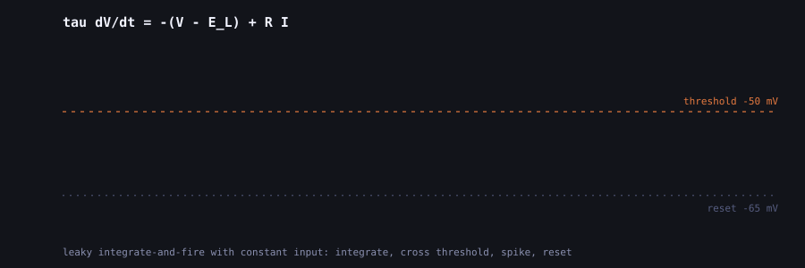
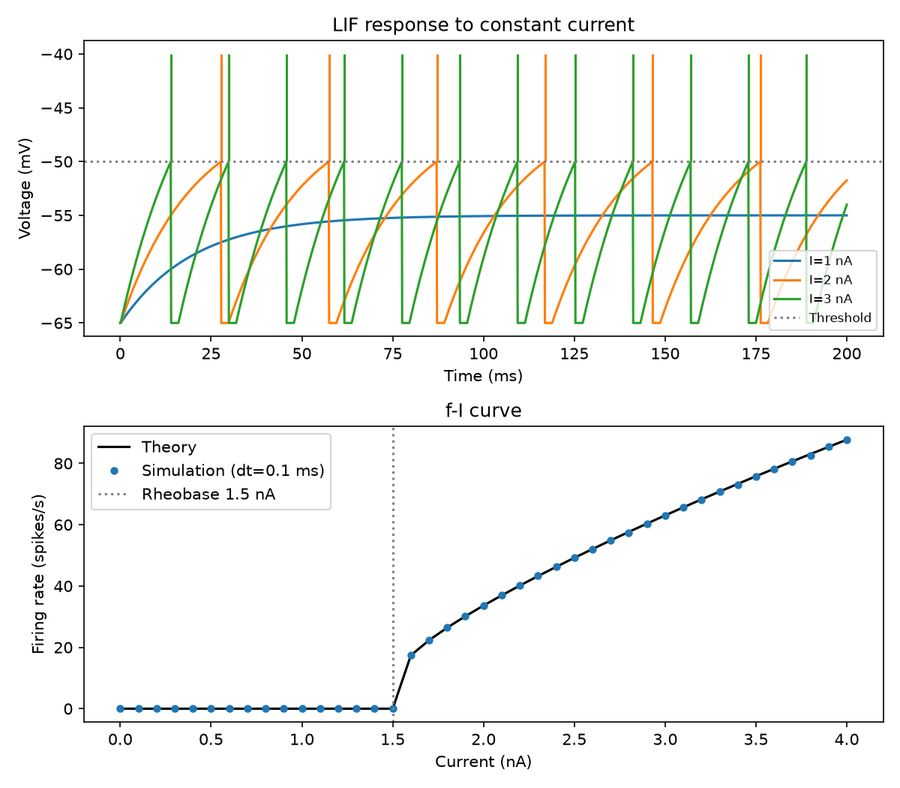
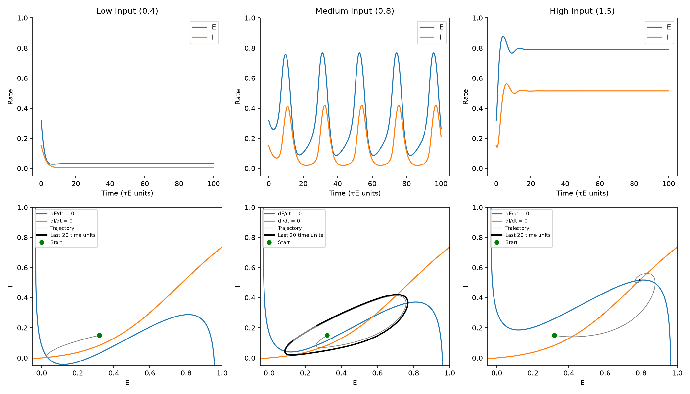
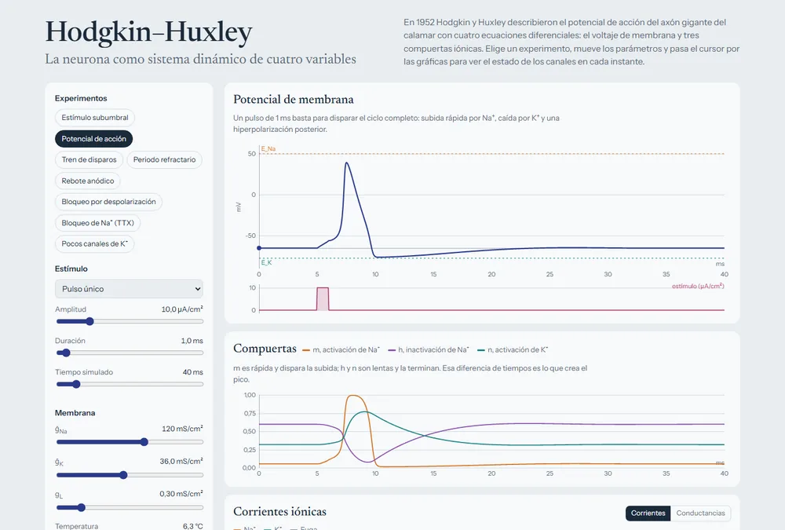
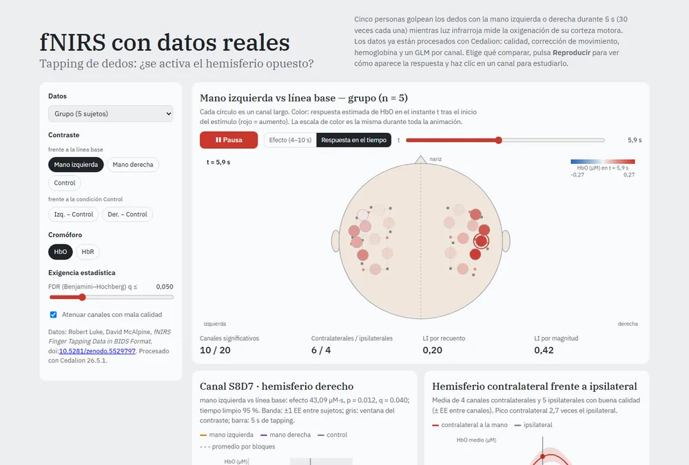

Most of what I have written on this blog is about artificial neural networks. Layers, losses,
optimizers. And for a long time that was enough. Then one day I realised I could train a
transformer but could not explain why an actual neuron fires. The word "neuron" in my own code
was borrowed, and I had never looked at where it came from.

So I gave myself a project. Learn computational neuroscience properly, and do it the only way that
sticks for me: by building every model, breaking it, and checking whether I understood it.

That little trace is where everything started. It is the leaky integrate-and-fire neuron: the
voltage charges up like a leaky capacitor, hits a threshold, fires, and resets. It is almost
embarrassingly simple, and I still came back to it more than to any other model.

## Eighteen weeks, on purpose

I wanted a plan I could actually finish next to a full-time job, so I settled on 18 weeks of 5-8
hours each. The first block is about single neurons (LIF, Hodgkin-Huxley, synapses). The second
moves to dynamics and networks: fixed points, populations that oscillate, Hopfield memories, noisy
spike trains. The third is about fitting models to data, and the last one is a specialization and
a capstone.

Most of the material comes from the [Neuromatch Academy](https://compneuro.neuromatch.io/)
curriculum, which is free and excellent. My roadmap only links to it; the code and the notebooks
are my own take on each topic.

## The figures that lied to me

Every week ends in the same way: a Python script that runs one experiment, draws a figure, and
then checks the result with a few `assert`s. The notebook you see on GitHub is generated from that
script, so there is only one source to keep up to date, and a test fails if they drift apart.

The checks felt like overkill at first. They stopped feeling that way quickly.

In week 4 I blocked the potassium channels of a Hodgkin-Huxley neuron to see what happens to the
action potential. The plot showed a big swing of voltage right at the start, before any stimulus,
and for a while I tried to explain it as biology. It was not. I was starting the simulation at
-65 mV, a resting potential that simply does not exist once potassium is gone; the real equilibrium
sits above -20 mV. The neuron was just falling towards it. In week 13 the text claimed standard
errors for a Poisson model that the code never computed. Both looked perfectly reasonable on the
page.

Week 3 is my favourite kind of check. The simulated firing rate has to land on the analytic f-I
curve, point by point, and nothing fires below the 1.5 nA rheobase:

And week 8 is where dynamics finally clicked for me. Same Wilson-Cowan circuit, same connections;
only the input changes, and the populations go quiet, start oscillating, or saturate:

## Sliders beat paragraphs

Reading that a system "undergoes a Hopf bifurcation" did very little for me. Dragging a slider
until a fixed point turns into an orbit did a lot. So the key models also got their own page: plain
HTML and JavaScript, nothing to install, and they work on a phone.

There are nine of them now:

| Module | What I use it for |
| --- | --- |
| [LIF neuron](https://hiroforyou.github.io/computational-neuroscience/interactive/lif.html) | Watching noise turn regular firing into irregular firing |
| [Hodgkin-Huxley](https://hiroforyou.github.io/computational-neuroscience/interactive/hodgkin-huxley.html) | Seeing which gate does what during a spike |
| [Synapses](https://hiroforyou.github.io/computational-neuroscience/interactive/sinapsis.html) | How close two inputs must be to add up |
| [2D linear systems](https://hiroforyou.github.io/computational-neuroscience/interactive/sistemas-lineales.html) | Clicking around the trace-determinant plane |
| [Wilson-Cowan](https://hiroforyou.github.io/computational-neuroscience/interactive/wilson-cowan.html) | Finding the input where oscillations begin |
| [Hopfield network](https://hiroforyou.github.io/computational-neuroscience/interactive/hopfield.html) | Corrupting a memory and watching it come back |
| [Poisson spike trains](https://hiroforyou.github.io/computational-neuroscience/interactive/poisson.html) | How a refractory period changes "random" |
| [Bayesian decision](https://hiroforyou.github.io/computational-neuroscience/interactive/decision-bayesiana.html) | Moving the prior and the decision boundary |
| [fNIRS with real data](https://hiroforyou.github.io/computational-neuroscience/interactive/fnirs.html) | The one below |

Making them work on a phone was more annoying than building them. The charts looked stretched on
my phone because every redraw scaled the canvas by the pixel ratio one more time. And I could not
even test a real phone width on my laptop, because Windows will not let a browser window get much
narrower than 500 px, so I ended up checking each page inside a 390 px frame.

## Then I wanted real data

Simulations only take you so far. At some point you want to see a signal that came out of an
actual head. I found [Cedalion](https://github.com/ibs-lab/cedalion), a Python framework for fNIRS,
which measures changes in blood oxygenation through the scalp with near-infrared light. Its
tutorial uses a classic experiment: tap the fingers of one hand, and the motor cortex on the
**opposite** side should get more oxygenated blood.

I analysed one subject in a notebook, using the first 1000 seconds of the recording, 8 trials per
hand. (With the full recording the model fit took over half an hour, which is too long for
something I wanted to rerun often.)

The left hand worked beautifully. Twelve channels showed a significant increase in oxygenated
hemoglobin, and 11 of them were on the right hemisphere, exactly where they should be. The
strongest one peaked around 8 seconds after tapping started, and a plain block average without any
model matched the fitted response with r = 0.88. The right hand pointed the same way, but no channel
survived the correction for multiple comparisons. With 8 trials, I am leaving that one open.

The part I learned the most from was a mistake I almost kept. The original tutorial compares
tapping against a "Control" condition, and I did the same. The right hand came out bilateral, which
made no sense. Looking closer, the Control condition itself was **lowering** oxygenation in 10
channels, so subtracting it painted those drops as activations. Comparing against rest instead made
the pattern disappear. I had treated the choice of baseline as a coding detail, and it was really
part of the question I was asking.

### A license I almost missed

When I wanted to put this data in a public demo, I read the dataset's README properly: *"Please use
only for Cedalion example notebooks. No other use permitted."* So the notebook downloads that data
when it runs, and the repository never ships it. For the demo I switched to an open dataset,
[fNIRS Finger Tapping Data in BIDS Format](https://doi.org/10.5281/zenodo.5529797) by Robert Luke
and David McAlpine, with 5 subjects and 30 trials per condition. A script runs the same analysis on
all of them in about 18 minutes and writes the results into a file the page loads directly.

You can pick a subject or the group average and press play to watch the response build up over
the motor cortex and fade after the 10 seconds of tapping. Lateralization comes out contralateral
in 9 of the 10 subject-hand combinations, which was a relief after the single-subject drama.

## Where it stands

All 18 weeks have their script and notebook, each one validated. The nine demos are online. The
fNIRS extension has its notebook and its demo. Synaptic plasticity and reinforcement learning are
still missing, and they are next on the list. The code is MIT licensed, and every dataset keeps its
own terms.

None of this replaces a real course or the papers, and the fNIRS part is for learning, not for
anything clinical. But I have something now that I did not have when I started: for every model in
the roadmap, I can guess what a parameter change will do, run it, and find out whether I was right.
Usually I am not, and that is the useful part.

If you want to poke at it:

- Code and notebooks: [github.com/HiroForYou/computational-neuroscience](https://github.com/HiroForYou/computational-neuroscience)
- Interactive modules: [hiroforyou.github.io/computational-neuroscience/interactive](https://hiroforyou.github.io/computational-neuroscience/interactive/)
- The Cedalion tutorial paper: Middell, E. et al. (2026), *Neurophotonics* 13(S3), S32602, [doi:10.1117/1.NPh.13.S3.S32602](https://doi.org/10.1117/1.NPh.13.S3.S32602)
