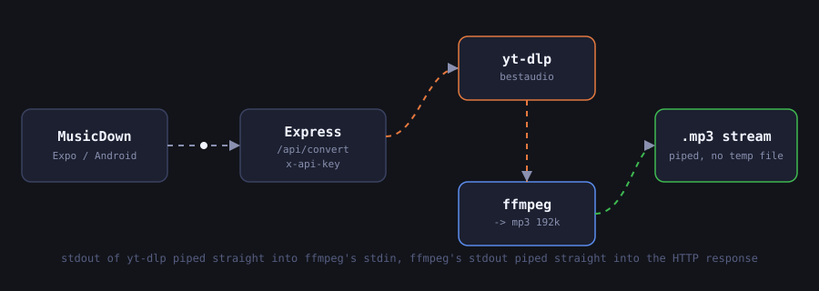
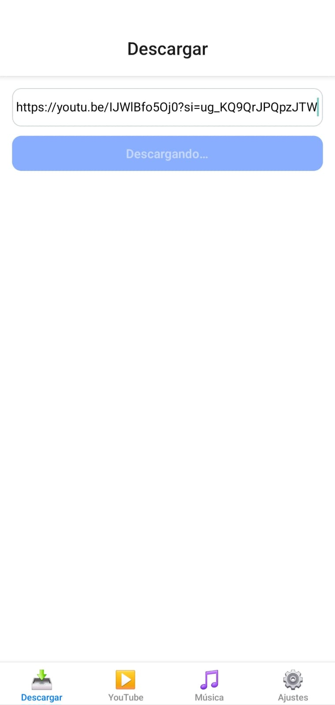
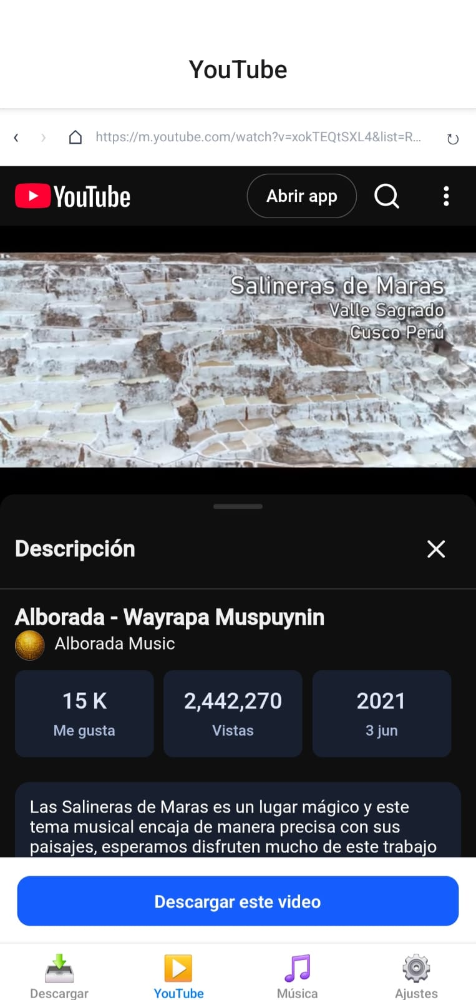
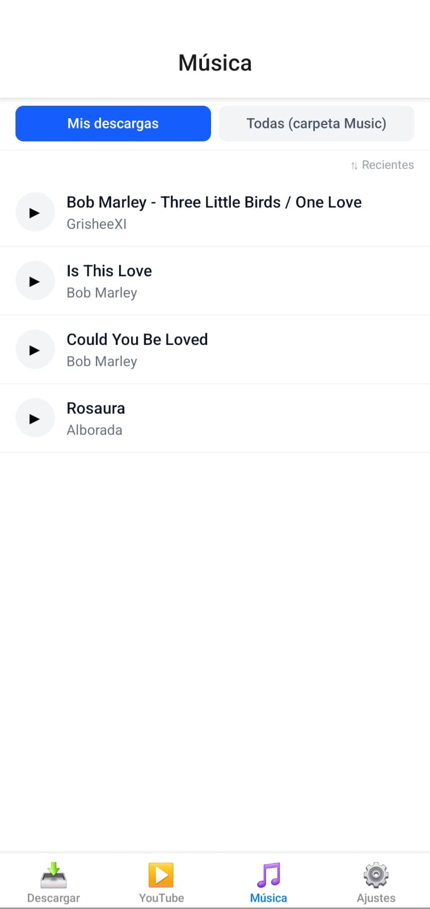
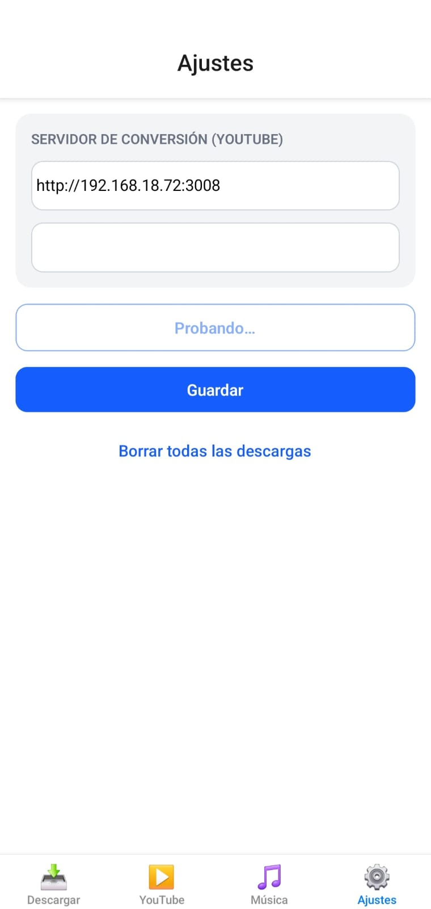
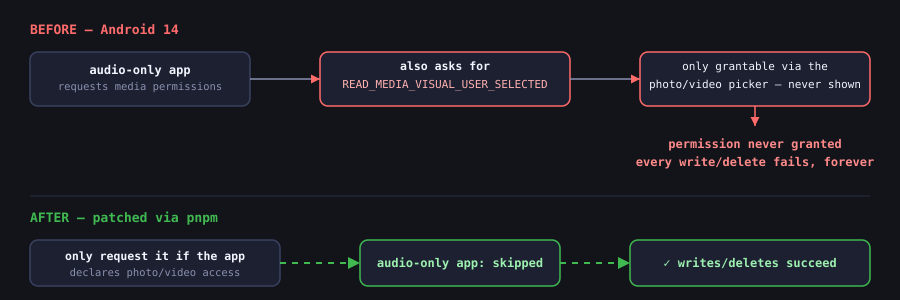

Casi todos los días hago el mismo trayecto, y siempre es la misma historia: la señal se cae apenas
el bus entra a un túnel, y lo que sea que estaba escuchando en streaming se traba hasta detenerse.
Llevaba meses queriendo resolver esto de verdad; no con otra app que "guarda para escuchar sin
conexión" detrás de una suscripción, sino con algo ridículamente simple: pegas un link, obtienes un
archivo MP3 de verdad, y es tuyo. Esta semana por fin me senté a construirlo. Se llama
**MusicDown**, y terminó siendo un curso intensivo sobre los permisos de medios de Android mucho
mejor de lo que esperaba.

> **Aclaración rápida:** este es un proyecto personal, hecho únicamente para mi uso privado; no es
> un producto comercial ni una invitación a infringir los derechos de autor de nadie. Si construyes
> algo parecido, respeta a los artistas y los términos de servicio de las plataformas.

Son dos proyectos pequeños que se comunican entre sí: una app en Expo/React Native en el celular, y
un servidor Node chiquito que se encarga de la conversión de audio propiamente dicha. Así fue como
lo armé, pantalla por pantalla, bug por bug.

## ¿Por qué necesita un servidor?

Mi primer instinto fue: "¿qué tan difícil puede ser hacer esto en el mismo dispositivo?". Resulta
que lo suficiente como para rendirme en menos de una hora. Las apps móviles no pueden ejecutar
`ffmpeg` o `yt-dlp` de forma confiable, así que la conversión tiene que pasar en otro lado. Mantuve
el servidor aburrido a propósito: solo Express, sin librería de YouTube, sin base de datos:



```js
// server.js (simplified)
const ytdlp = spawn(YTDLP_PATH, ['-f', 'bestaudio/best', '--no-playlist', '--newline', '-o', '-', url]);
const ffmpeg = spawn(FFMPEG_PATH, ['-i', 'pipe:0', '-vn', '-f', 'mp3', '-b:a', '192k', 'pipe:1']);

ytdlp.stdout.pipe(ffmpeg.stdin);
ffmpeg.stdout.pipe(res); // straight into the HTTP response, no temp files on disk
```

Nada toca nunca el disco del servidor: el stdout de `yt-dlp` va directo al stdin de `ffmpeg`, y el
stdout de `ffmpeg` va directo a la respuesta HTTP. El único detalle: como el body de la respuesta
*es* el MP3 binario, no puede llevar también actualizaciones de progreso en JSON. Así que busco con
una regex `[download]  NN.N%` en el stderr de `yt-dlp`, lo guardo en un mapa en memoria indexado por
un `jobId` que genera la app, y dejo que la app consulte periódicamente un endpoint aparte mientras
se llena la barra de progreso.

| Endpoint | Qué hace |
| --- | --- |
| `GET /api/health` | lo usa el botón "Probar conexión" de la app |
| `GET /api/metadata?url=` | ejecuta `yt-dlp -j` y devuelve título/artista/miniatura/duración |
| `GET /api/progress?jobId=` | se consulta durante la conversión para la barra de progreso |
| `GET /api/convert?url=&filename=&jobId=` | devuelve el `audio/mpeg` en streaming |

La autenticación es un único header `x-api-key`, que solo se exige si de verdad configuro una
variable de entorno `API_KEY` (el servidor me lanza una advertencia al arrancar si se me olvida).
Hay un `Dockerfile` que descarga el binario más reciente de `yt-dlp` directo de los releases de
GitHub, pero, siendo honesto, por ahora solo lo estoy corriendo en mi propia máquina dentro de la
red de mi casa. El README que escribí deja claro que es para uso personal y no algo para exponer
públicamente, ya que volver a servir audio de YouTube de esta forma está en una zona gris legal y no
tiene ningún rate limiting.

## Cuatro pestañas, un solo componente Button compartido

Del lado de la app usé Expo SDK 54, `expo-router` para la navegación basada en archivos, y
Nativewind (Tailwind v4, pero para React Native) para los estilos, en lugar de meter un UI kit
completo. Escribí un solo componente `Button` con variantes filled/outlined/text y lo reutilicé en
todas partes; en parte por disciplina, en parte por no querer pasarme el fin de semana eligiendo un
design system.

Estas son capturas reales de mi celular, y se nota: es una primera versión funcional. Toda la
lógica funciona de punta a punta, pero todavía no he tocado nada del acabado visual: fuentes del
sistema por defecto, ningún ícono aparte de los emojis de la barra de pestañas, fondos blancos
lisos. Eso viene después; por ahora solo quería que todo el flujo funcionara.

### Descargar



La puerta de entrada. Pegas un link, tocas el botón, y la app se encarga de obtener la metadata,
recibir la conversión en streaming y guardar el MP3 etiquetado en `Music/`. Por ahora, la propia
etiqueta del botón funciona como el único indicador de progreso (`Descargando…`).

### YouTube



Un navegador dentro de la app (`react-native-webview`) apuntando a `m.youtube.com`, con un script
de bloqueo de anuncios inyectado del que estoy un poco orgulloso: oculta los banners, hace clic
automáticamente en los botones de "saltar anuncio" y, para los que no se pueden saltar, simplemente
adelanta el video a la fuerza hasta su propia duración. El botón **Descargar este video** de abajo
solo se activa cuando la página actual es realmente la URL de un video, y reutiliza exactamente el
mismo flujo de descarga que la pestaña Descargar.

### Música



La biblioteca, con un selector entre **Mis descargas** (canciones descargadas desde la app) y
**Todas (carpeta Music)** (todo lo que ya está en la carpeta Music del celular, que necesita un
build en un dispositivo real para poder leerse). Si tocas una canción que descargaste, se abre una
**pantalla de edición** (todavía no tengo captura de esa) donde puedes reescribir el título, artista
y álbum del ID3 y cambiar la portada, ya sea desde tu galería o buscando con la iTunes Search API
ahí mismo en la app.

### Ajustes



Solo la URL del servidor, la API key, un botón para probar la conexión (en plena prueba en esa
captura; el mío apunta a la IP de mi máquina en la red local) y, porque estoy seguro de que algún
día lo voy a necesitar, un botón de "borrar todo" con un diálogo de confirmación.

## La parte que de verdad se comió mi sábado

Todo lo anterior salió más rápido de lo que esperaba. Lo que no fue el modelo de permisos de
almacenamiento de Android, que ha cambiado tanto entre las versiones 11, 13 y 14 que la mitad de los
posts que encontré mientras depuraba ya estaban desactualizados.

### El muro de permisos de Android 14

El que más tiempo me costó: en Android 14, **cada escritura y cada borrado de mis propios archivos
descargados fallaba en silencio**, sin ningún error que pudiera encontrar por ningún lado. Me tomó
una tarde larga, con el código fuente de `expo-media-library` abierto en una pestaña y la
documentación de permisos de Android en otra, entender por qué.



La lógica de permisos de la librería pedía incondicionalmente `READ_MEDIA_VISUAL_USER_SELECTED`, un
permiso que *solo* se puede otorgar a través del selector de acceso parcial a fotos y videos. Una
app que solo maneja audio nunca muestra ese selector, así que el permiso nunca se otorga, y cada
llamada de escritura o borrado simplemente falla, para siempre, en Android 14+. Terminé parcheando
el propio código Kotlin de permisos de la librería (aplicado automáticamente con los
`patchedDependencies` de pnpm, para no tener que acordarme de volver a aplicarlo) de modo que solo
pida ese permiso cuando la app realmente declara acceso a fotos o videos, cosa que la mía nunca hace.

### Mordiscos más pequeños de la misma madriguera

- **Nada de carpetas por álbum.** `createAlbumAsync` hace I/O directo sobre el sistema de archivos,
  lo que requiere un permiso `WRITE_EXTERNAL_STORAGE` que Android 13+ ya no otorga.
  `createAssetAsync` por sí solo usa la ruta moderna de inserción de MediaStore y deja el archivo
  directo en `Music/` sin chocar con ese muro, así que simplemente dejé de intentar agrupar las
  canciones en álbumes.
- **Solo escritura, a propósito.** La app solo crea assets nuevos y nunca lee la biblioteca
  existente a través de este permiso, así que pide explícitamente acceso de solo escritura; eso
  además esquiva el permiso granular de lectura de "audio" que Expo Go ni siquiera declara en su
  manifest.
- **Borrar necesita la API nueva.** El antiguo `deleteAssetsAsync()` no implementa el flujo de
  consentimiento del usuario que exige Android 11: puede quedarse sin hacer nada en silencio en
  lugar de borrar. El `Asset.delete()` de `expo-media-library/next` sí dispara correctamente el
  diálogo de confirmación real del sistema.
- **Expo Go no alcanza.** Leer toda la carpeta Music requiere `READ_MEDIA_AUDIO`, que el manifest
  fijo de Expo Go no puede incluir; solo un development client personalizado, compilado con EAS,
  trae de verdad los permisos nativos que agregan mis config plugins. Por eso mis perfiles de EAS de
  dev y preview generan un APK simple para instalar manualmente, en lugar del formato AAB de la Play
  Store.
- **Un enum roto.** `browser-id3-writer` declara su `ImageType` como un `const enum` de TypeScript,
  que se borra en tiempo de compilación; pero el paquete publicado trae JS plano sin ningún export
  en runtime para él, así que `ImageType.CoverFront` termina siendo `undefined` sin que nadie se
  entere. Simplemente hardcodeé el byte crudo del tipo de imagen APIC (`0x03`), envuelto en un
  try/catch para que una miniatura defectuosa de YouTube no tumbe una descarga entera.

## En qué punto está

Todavía no hay descargas en segundo plano ni notificaciones: todo corre mientras la pestaña
Descargar o YouTube está abierta, y eso es lo siguiente obvio por construir. Pero, a partir de este
fin de semana, tengo un pipeline funcionando que va desde "pegar un link" hasta "MP3 etiquetado,
con portada real, guardado en mi app de Música", y un modelo mental mucho más claro de exactamente
dónde el sistema de permisos de Android decide morderte.
