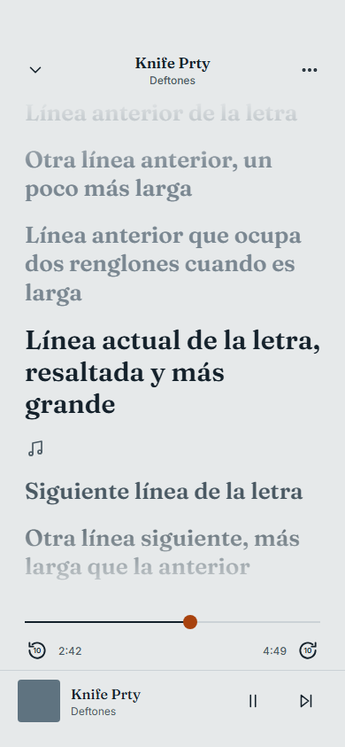

El [primer post de MusicDown](/es/blog/musicdown-android-mp3-downloader-expo/) terminaba con dos
pendientes: el pulido visual y todo lo que funcionara en segundo plano. Los dos quedaron
resueltos, pero resultaron ser la parte menor del trabajo. Al usar la app a diario, casi todo lo
que había que arreglar tenía que ver con **la reproducción**: que la canción siga sonando con la
pantalla apagada, controlarla desde la pantalla de bloqueo y lograr que un botón de la
notificación haga lo que indica su ícono.

> **El mismo aviso de antes:** es un proyecto personal, para uso privado. No es un producto ni un
> servicio, y no es una invitación a ignorar los derechos de autor ni los términos de uso de nadie.

## Qué cambió

| | Julio | Noviembre |
| --- | --- | --- |
| Pestañas | Descargar · YouTube · Música · Ajustes | Música · Spotify · Descargar · Ajustes |
| Aspecto | Fuentes del sistema, íconos con emojis, blanco | Fraunces + Inter, íconos Feather, un solo color de acento |
| Reproductor | Controles distintos en cada pantalla | Uno global: mini barra, pantalla completa, letras, cola, aleatorio, repetir |
| Spotify | — | Likes sincronizados en ambos sentidos con la laptop, reproducibles sin descargar |
| Biblioteca | Solo descargas | Playlists y "Me Gustan", con respaldo en el servidor |
| Pantalla de bloqueo | — | Notificación multimedia con anterior / play / siguiente |
| Pantalla de inicio | — | Nueve variantes de widget |
| Extras | — | Reproductor teñido por la portada, ahorro de energía, modo sin conexión, descargas privadas |

## El rediseño

Esta vez diseñé las pantallas antes de escribir código: un archivo HTML con todas las pantallas
lado a lado, que luego pasé a React Native. Las capturas de este post salen de ese archivo; la app
es prácticamente idéntica.


Todo el sistema visual cabe en `theme.ts`:

```ts
// Papel gris azulado, tinta oscura y un único acento terracota.
export const colors = {
  bg: '#E6E9EA',
  ink: '#14212B',
  muted: '#4A5963',
  line: '#CBD0D3',
  accent: '#A8420E',
};
```

**Fraunces** para títulos, nombres de canciones y números de pista; **Inter** para el resto de la
interfaz. El color de acento tiene un solo significado, *lo que está sonando*, y nada más lo usa.
Las canciones sin portada reciben un color plano de una paleta de cinco tonos, elegido con un hash
del id, así que cada canción siempre se ve igual.

"Descargar" y "YouTube" hacían lo mismo, así que ahora son una sola pestaña con un selector
**Enlace / YouTube**, una lista de descargas con barra de progreso y un aviso al guardar el
archivo.


## Los likes de Spotify, sin la API de Spotify

Quería ver mis likes de Spotify en MusicDown. La Web API no sirve bien para una app personal,
porque el desarrollador dueño de la app necesita Premium para usarla.

El cliente de escritorio, en cambio, ya tiene mis likes, y [Spicetify](https://spicetify.app/)
permite ejecutar JavaScript dentro de él:

1. Una extensión de Spicetify lee los likes con la sesión del propio cliente. Sin client ID, sin
   OAuth, sin Premium.
2. Envía la lista con `POST` a mi servidor de MusicDown (`/api/spotify-likes`).
3. El celular la pide con `GET` desde ahí.

Spicetify expone las APIs *internas* de Spotify, que cambian entre versiones del cliente. Por eso
la extensión prueba tres estrategias en orden (el GraphQL interno, el objeto `LibraryAPI` y la Web
API a través de la sesión del cliente) y se queda con la primera que funcione:

```js
for (const [name, strategy] of [['graphql', viaGraphQL], ['libraryapi', viaLibraryAPI], ['webapi', viaWebAPI]]) {
  try {
    return await strategy();
  } catch (e) {
    errors.push(`${name}: ${e.message}`); // probar la siguiente
  }
}
```

También escucha los eventos `update` de la biblioteca, así que un like nuevo se sincroniza tres
segundos después (con debounce), y hace una sincronización silenciosa cada vez que se abre
Spotify.


Ahora la sincronización también funciona en sentido contrario. Al eliminar un like desde la app se
llama a `DELETE /api/spotify-likes/:id`, y el servidor agrega ese id a una lista de eliminaciones
pendientes. Mientras Spotify está abierto, la extensión revisa esa lista cada minuto (y antes de
cada sincronización), quita esas canciones de mi biblioteca real de Spotify y se lo confirma al
servidor. Hasta recibir esa confirmación, el servidor filtra los ids eliminados de las
sincronizaciones entrantes, para que una canción borrada no vuelva a aparecer. Quitar likes de
Spotify se puede desactivar en los ajustes de la extensión.

En el celular la lista queda en caché para usarla sin conexión. La primera versión la guardaba en
AsyncStorage, que en Android falla al leer valores de más de unos 2 MB, y las bibliotecas grandes
dejaban de cargar. Ahora la caché es un archivo JSON en el directorio de documentos de la app.

## Un reproductor, dos motores

Un like es solo un título y un artista, así que la app tiene que encontrar el audio. Además quería
que se comportara como una canción descargada: el mismo mini reproductor, la misma cola y los
mismos controles de bloqueo. Un único `BackgroundPlayerProvider` elige el motor para cada pista:


**Los archivos descargados** se reproducen con `expo-audio`.

**Los likes de Spotify** suenan por defecto con una WebView oculta. Abre
`m.youtube.com/results?search_query=…`, un script inyectado elige el primer resultado real (sin
videos promocionados ni Shorts) y la app controla el elemento `<video>` con dos globales,
`__mdSetDesired('play' | 'pause')` y `__mdSeek(segundos)`. Cada segundo, el script reporta la
posición, la duración y si hay un anuncio, y así el mini reproductor puede mostrar *Anuncio*.

En el primer intento oculté la WebView con `width: 0` y `display: none`, y Chromium no reproducía
nada. Ahora sigue montada en 360×640 con `opacity: 0`.

**El streaming desde el servidor** es una opción en Ajustes. Si está activado y el servidor
responde a una comprobación de salud en menos de 2,5 s, la app llama a
`/api/stream?q=artista título`. El servidor ejecuta `yt-dlp "ytsearch1:artista título"`, guarda el
audio en una caché en disco con un hash de la búsqueda como nombre (máximo 60 archivos, se borran
primero los más antiguos) y lo sirve con `res.sendFile`, que maneja las peticiones con `Range`.
Los pedidos simultáneos de la misma canción comparten una sola descarga.

Antes de pasarle esa URL al reproductor nativo, la app hace su propia petición
`Range: bytes=0-0` con un límite de 70 s. Así el servidor termina de descargar primero, y el
reproductor recibe una respuesta inmediata en vez de agotar su propio tiempo de espera, que es más
corto. Si a los 20 s `expo-audio` todavía no cargó, la pista pasa a la WebView.


El reproductor a pantalla completa también puede teñir su fondo con el color de la portada
(Ajustes → Temas). `coverColor.ts` decodifica la imagen en JavaScript (`jpeg-js` o `upng-js`),
toma unas 4.000 muestras y elige el tono más saturado, ignorando blancos, negros y grises. El
promedio de los píxeles suele dar un marrón apagado. Ese tono se convierte luego en un pastel
claro, sea como sea la portada, para que el texto oscuro se siga leyendo. Los colores de las
siguientes canciones de la cola se calculan por adelantado, así que el fondo puede pasar al color
nuevo en cuanto cambia la canción.

## Que la WebView siga sonando con la pantalla apagada

Al bloquear el celular, el audio de la WebView se detenía por dos motivos distintos.

**El JavaScript de YouTube** pausa la reproducción cuando la Page Visibility API indica que la
página está oculta. Un script inyectado antes de que cargue la página lo evita:

```js
Object.defineProperty(document, 'hidden', { get: () => false });
Object.defineProperty(document, 'visibilityState', { get: () => 'visible' });
window.addEventListener('visibilitychange', (e) => e.stopImmediatePropagation(), true);
```

El listener en fase de captura sobre `window` se ejecuta antes que los de YouTube y detiene el
evento. Como respaldo, si el video se pausa igual dentro de los tres segundos posteriores a que la
página se oculte, el script lo reanuda. Pasado ese margen no interviene, para no interferir con
llamadas ni con otras apps de audio.

**Android** también le avisa a la WebView cuando su ventana deja de ser visible, y Chromium pausa
entonces cualquier video con imagen. JavaScript no llega a esa capa, así que parcheé
`react-native-webview` (aplicado con `patchedDependencies` de pnpm):

```java
@Override
protected void onWindowVisibilityChanged(int visibility) {
    super.onWindowVisibilityChanged(View.VISIBLE); // siempre visible, hasta donde Chromium sabe
}
```

## Un WAV silencioso para la pantalla de bloqueo

Android arma la tarjeta multimedia de la pantalla de bloqueo a partir de una sesión multimedia, y
una WebView que reproduce un `<video>` no tiene ninguna.

La solución: un segundo reproductor de `expo-audio` repite `assets/silence.wav` en bucle mientras
el motor de WebView está activo. Ese reproductor es el dueño de la sesión multimedia, así que la
notificación muestra el título, el artista y la portada correctos. El modo de audio usa
`mixWithOthers` para que la pista silenciosa no le quite el foco de audio a la WebView. Ambos se
mantienen sincronizados: si uno pausa, el otro también, y una pausa desde la pantalla de bloqueo
se reenvía a la WebView con `__mdSetDesired('pause')`.

Ese mismo reproductor silencioso ahora tiene un segundo trabajo. Con la pantalla apagada, Android
suspende las apps que no tienen un servicio en primer plano, y eso frenaba las descargas en lote
de likes. Durante un lote, si no está sonando nada, la pista silenciosa arranca con una
notificación multimedia "Descargando…", y la app sigue activa y con acceso a la red hasta que
termina.

## Botones que mienten

En esta versión, los controles de bloqueo de `expo-audio` solo ofrecen **retroceder** y
**adelantar**. No hay botón de pista anterior ni siguiente.

Primero parcheé el servicio en Kotlin de `expo-audio` para que esos dos botones muestren los
íconos de "anterior" y "siguiente". Los comandos no cambian: "siguiente" sigue adelantando diez
segundos.

Después, en cada actualización de estado, la app compara cuánto avanzó la canción con cuánto
tiempo pasó. En una reproducción normal coinciden. Un salto de entre 6 y 20 segundos que la app no
provocó tiene que venir de uno de esos botones:


```ts
const elapsed = playing ? (now - prev.t) / 1000 : 0;
const jump = pos - prev.pos - elapsed;
if (Math.abs(jump) >= 6 && Math.abs(jump) < 20) {
  ignoreJumpUntil.current = now + 1500;
  jump > 0 ? next() : previous();
}
```

Cada salto que la app hace a propósito (la barra de progreso, los botones de ±10 s, cargar una
pista) marca primero `ignoreJumpUntil`, así que solo se traducen los toques externos. Como
"anterior" reinicia la canción si ya pasaron más de cinco segundos, los diez segundos que ya
retrocedió no importan. Con el motor de WebView, el salto se detecta en la pista silenciosa,
porque es la que controla la pantalla de bloqueo.

## Letras

Las letras vienen de [LRCLIB](https://lrclib.net), una API gratuita y sin clave. Los títulos de
YouTube traen ruido, así que la búsqueda quita cosas como `(Official Video)` o `feat.`, prueba a
separar "Artista - Canción" y prefiere resultados con tiempos y una duración parecida a la de la
canción.



La vista de letras usa tres niveles: líneas pasadas tenues, la actual grande y oscura, y las
siguientes en gris medio. Sigue la canción hasta que desplazas la letra; entonces aparece un botón
"Línea actual", y el seguimiento se reanuda solo seis segundos después de que dejas de tocar la
pantalla. Al tocar una línea aparece un botón con su tiempo (▶ 2:55) que salta ahí. Las letras sin
tiempos reciben uno aproximado según el lugar de la línea en la canción.

Dos reglas de caché: nunca se guarda una petición cancelada, ni una en la que fallaron todas las
llamadas, porque eso significa que no hay red, no que no haya letra. En ambos casos la canción
tiene otra oportunidad la próxima vez.

## Playlists que sobreviven a una reinstalación

La pestaña Música tiene ahora una tercera vista, **Listas**, junto a "Mis descargas" y "Todas".
Hay una playlist automática, "Me Gustan": un doble toque en la portada del reproductor agrega o
quita la canción (con un aviso para deshacer), y un corazón color óxido junto al título indica
cuándo está en la lista.

Una entrada de playlist no depende del archivo de la canción. Se identifica por el id de Spotify,
el id de descarga o el id del archivo externo, y guarda el título, el artista y la portada. Si un
archivo desaparece, por ejemplo tras reinstalar, la canción sigue en la lista. Si es un like de
Spotify, se puede escuchar en streaming o descargar otra vez; si no hay forma de reproducirla, se
omite.

Cada cambio se respalda en el servidor (`PUT /api/library-backup`, con 3 s de espera para agrupar
cambios, y solo si el servidor está conectado). En una instalación nueva, sin playlists locales,
la app restaura el respaldo del servidor. Hasta que no se intenta esa restauración no se sube
nada. Si no, una instalación nueva pisaría un buen respaldo con una lista vacía en su primera
sincronización.

## Hacer menos cuando nadie está mirando

La música suele sonar horas con la pantalla apagada, así que el reproductor evita el trabajo que
nadie va a ver:

- Los eventos del reproductor nativo se atienden fuera de React: el fin de canción y los botones
  de bloqueo funcionan con la pantalla encendida o apagada, pero el estado de React solo se
  actualiza con la app en primer plano, y como mucho una vez por intervalo, salvo los cambios
  importantes (play/pausa, carga, fin).
- Los eventos del reproductor llegan una vez por segundo en vez de cada 500 ms, que es el valor
  por defecto.
- El **ahorro de energía** (activado por defecto) actualiza la barra de progreso cada 2 s y deja
  quietas animaciones como el ícono de ecualizador y los puntos de carga.
- El **modo sin conexión** apaga todo lo que usa la red: ping al servidor, sincronización,
  descargas, búsqueda de letras y portadas, y YouTube. Solo suena lo que ya está en el celular.

## Widgets en la pantalla de inicio

MusicDown tiene nueve variantes de widget hechas con `react-native-android-widget`: una fila de
4×1 y un formato medio de 4×2 (cada uno en versión sólida, semitraslúcida o transparente),
formatos con portada de 4×2 y 4×4, y un cuadrado de 2×2, con Fraunces incluida para los títulos.

Los widgets corren en una tarea aparte, sin interfaz, así que el reproductor publica la canción
actual en un pequeño módulo puente que los vuelve a dibujar y guarda el estado. Tras un arranque
en frío, el widget muestra la última canción en vez de quedar vacío. Las portadas requirieron
cuidado: un widget no puede leer URIs `file://`, y sus datos pasan por el Binder de Android, que
tiene un límite de alrededor de 1 MB. El puente convierte la portada en un data URI en base64,
descarta las de más de 400 KB y pide la versión de 300 px de las portadas de Spotify. Actualiza el
widget de inmediato con la portada anterior y otra vez cuando la nueva está lista.

## Cambios menores

- **Descargas privadas por defecto**: los archivos van al almacenamiento privado de la app con
  extensión `.zc3` y no se agregan a la biblioteca multimedia del sistema. Al compartir una
  canción se envía una copia temporal `Artista - Título.mp3`. Un ajuste permite volver al
  comportamiento anterior.
- **Likes sin conexión**: cualquier like se puede descargar, uno por uno o en lote. El primer
  resultado de YouTube para una búsqueda a veces es un mix de una hora, así que el servidor pide
  ocho candidatos y se queda con el primero que dure entre 45 segundos y 15 minutos. Un lote se
  detiene tras tres fallos seguidos, que normalmente significa que el servidor está apagado.
- **Los archivos de la carpeta Música** ahora muestran su título, artista y portada reales. Un
  pequeño lector de ID3v2 analiza solo el inicio de cada archivo, donde está la etiqueta, en vez
  del MP3 completo.
- **Estado del servidor**: la app le hace ping al abrir y al volver a primer plano, y deshabilita
  lo que depende de él. La reproducción local nunca depende de él. `npm run start:tunnel` levanta
  el servidor detrás de un túnel rápido de Cloudflare, así que el celular también funciona fuera
  de mi red.
- **La pantalla de edición** (etiquetas ID3 y portada, desde la galería o la API de iTunes) ya
  existía en julio; recién ahora se ve lo bastante bien para una captura.


## Dónde está ahora

En julio, lo difícil fueron los permisos de almacenamiento de Android. Esta vez fue la
reproducción: sesiones multimedia, visibilidad de la ventana y botones de notificación. Casi todas
las soluciones de este post consisten en engañar a alguna de esas capas: una página que dice estar
visible, un archivo silencioso en lugar de la música, un botón de adelantar que funciona como
"siguiente".

Queda una limitación. Con el motor de WebView, los controles de bloqueo y del widget solo se
aplican al volver a la app, porque React Native no les entrega órdenes a las vistas mientras la
app está en pausa. El streaming desde el servidor no tiene ese problema, porque `expo-audio`
responde en segundo plano, pero necesita el servidor encendido. Ese es el compromiso detrás del
ajuste.
