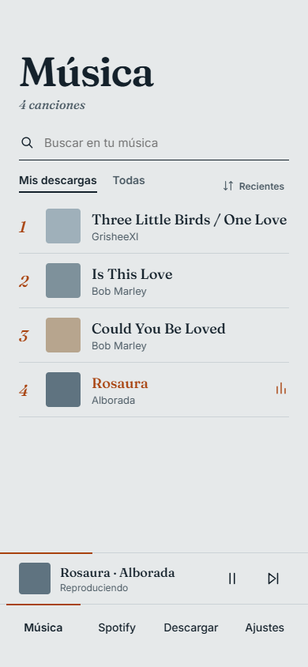
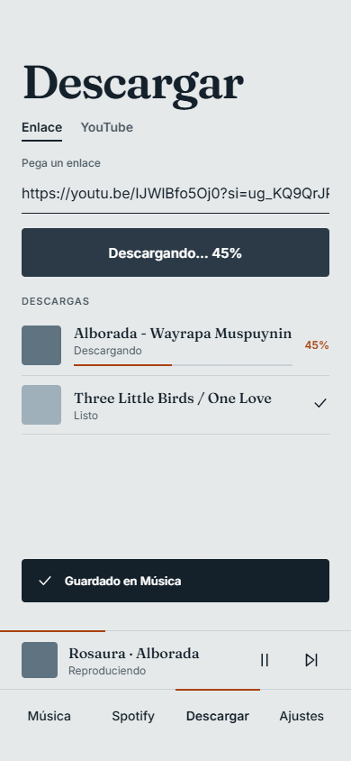
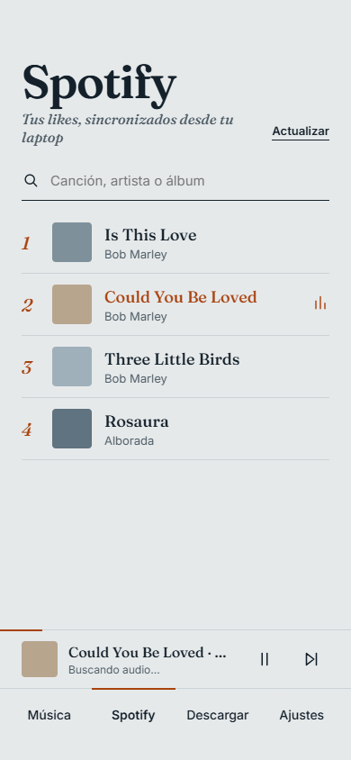
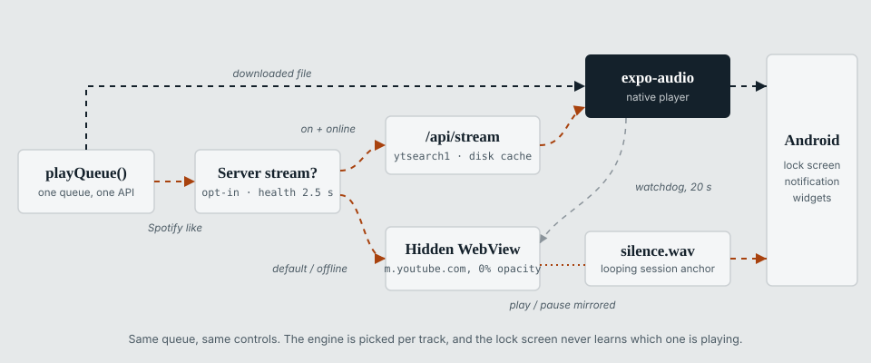
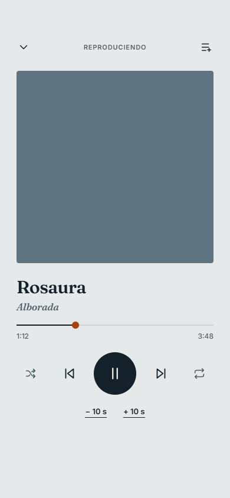
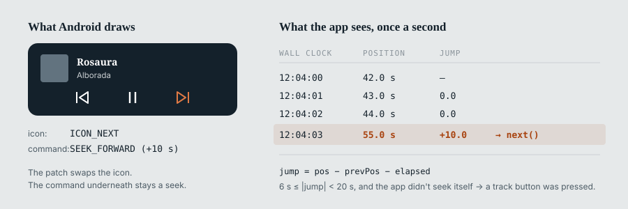
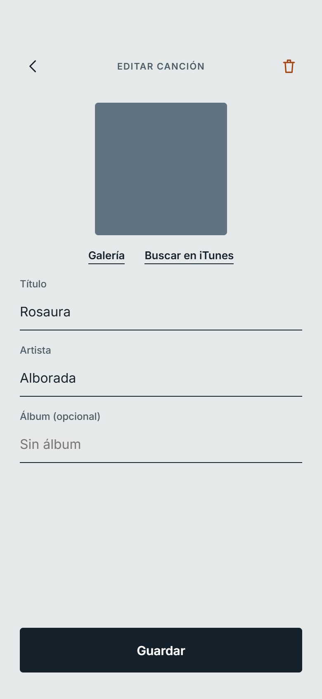

El [primer post de MusicDown](/es/blog/musicdown-android-mp3-downloader-expo/) terminaba con dos
pendientes: el pulido visual y todo lo que funcionara en segundo plano. Los dos quedaron
resueltos, pero resultaron ser la parte menor del trabajo. Al usar la app a diario, casi todo lo
que había que arreglar tenía que ver con **la reproducción**: que la canción siga sonando con la
pantalla apagada, controlarla desde la pantalla de bloqueo y lograr que un botón de la
notificación haga lo que indica su ícono.

> **El mismo aviso de antes:** es un proyecto personal, para uso privado. No es un producto ni un
> servicio, y no es una invitación a ignorar los derechos de autor ni los términos de uso de nadie.

## Qué cambió

| | Julio | Noviembre |
| --- | --- | --- |
| Pestañas | Descargar · YouTube · Música · Ajustes | Música · Spotify · Descargar · Ajustes |
| Aspecto | Fuentes del sistema, íconos con emojis, blanco | Fraunces + Inter, íconos Feather, un solo color de acento |
| Reproductor | Controles distintos en cada pantalla | Uno global: mini barra, pantalla completa, cola, aleatorio, repetir |
| Spotify | — | Likes sincronizados desde la laptop, reproducibles sin descargar |
| Pantalla de bloqueo | — | Notificación multimedia con anterior / play / siguiente |
| Pantalla de inicio | — | Siete variantes de widget |
| Extras | — | Letras sincronizadas, descargas privadas, compartir como `.mp3` |

## El rediseño

Esta vez diseñé las pantallas antes de escribir código: un archivo HTML con todas las pantallas
lado a lado, que luego pasé a React Native. Las capturas de este post salen de ese archivo; la app
es prácticamente idéntica.



Todo el sistema visual cabe en `theme.ts`:

```ts
// Papel gris azulado, tinta oscura y un único acento terracota.
export const colors = {
  bg: '#E6E9EA',
  ink: '#14212B',
  muted: '#4A5963',
  line: '#CBD0D3',
  accent: '#A8420E',
};
```

**Fraunces** para títulos, nombres de canciones y números de pista; **Inter** para el resto de la
interfaz. El color de acento tiene un solo significado, *lo que está sonando*, y nada más lo usa.
Las canciones sin portada reciben un color plano de una paleta de cinco tonos, elegido con un hash
del id, así que cada canción siempre se ve igual.

"Descargar" y "YouTube" hacían lo mismo, así que ahora son una sola pestaña con un selector
**Enlace / YouTube**, una lista de descargas con barra de progreso y un aviso al guardar el
archivo.



## Los likes de Spotify, sin la API de Spotify

Quería ver mis likes de Spotify en MusicDown. La Web API no sirve bien para una app personal,
porque el desarrollador dueño de la app necesita Premium para usarla.

El cliente de escritorio, en cambio, ya tiene mis likes, y [Spicetify](https://spicetify.app/)
permite ejecutar JavaScript dentro de él:

1. Una extensión de Spicetify lee los likes con la sesión del propio cliente. Sin client ID, sin
   OAuth, sin Premium.
2. Envía la lista con `POST` a mi servidor de MusicDown (`/api/spotify-likes`).
3. El celular la pide con `GET` desde ahí.

Spicetify expone las APIs *internas* de Spotify, que cambian entre versiones del cliente. Por eso
la extensión prueba tres estrategias en orden (el GraphQL interno, el objeto `LibraryAPI` y la Web
API a través de la sesión del cliente) y se queda con la primera que funcione:

```js
for (const [name, strategy] of [['graphql', viaGraphQL], ['libraryapi', viaLibraryAPI], ['webapi', viaWebAPI]]) {
  try {
    return await strategy();
  } catch (e) {
    errors.push(`${name}: ${e.message}`); // probar la siguiente
  }
}
```

También escucha los eventos `update` de la biblioteca, así que un like nuevo se sincroniza tres
segundos después (con debounce), y hace una sincronización silenciosa cada vez que se abre
Spotify.



En el celular la lista queda en caché para usarla sin conexión. La primera versión la guardaba en
AsyncStorage, que en Android falla al leer valores de más de unos 2 MB, y las bibliotecas grandes
dejaban de cargar. Ahora la caché es un archivo JSON en el directorio de documentos de la app.

## Un reproductor, dos motores

Un like es solo un título y un artista, así que la app tiene que encontrar el audio. Además quería
que se comportara como una canción descargada: el mismo mini reproductor, la misma cola y los
mismos controles de bloqueo. Un único `BackgroundPlayerProvider` elige el motor para cada pista:



**Los archivos descargados** se reproducen con `expo-audio`.

**Los likes de Spotify** primero comprueban si el servidor responde (límite de 2,5 s). Si
responde, la app llama a un endpoint nuevo, `/api/stream?q=artista título`. El servidor ejecuta
`yt-dlp "ytsearch1:artista título"`, guarda el audio en una caché en disco con un hash de la
búsqueda como nombre (máximo 60 archivos, se borran primero los más antiguos) y lo sirve con
`res.sendFile`, que maneja las peticiones con `Range`. Los pedidos simultáneos de la misma canción
comparten una sola descarga.

Antes de pasarle la URL al reproductor nativo, la app hace su propia petición
`Range: bytes=0-0` con un límite de 70 s. Así el servidor termina de descargar primero, y el
reproductor recibe una respuesta inmediata en vez de agotar su propio tiempo de espera, que es más
corto. Si a los 20 s `expo-audio` todavía no cargó, la pista pasa al segundo motor.

**El segundo motor** es una WebView oculta. Abre `m.youtube.com/results?search_query=…`, un script
inyectado elige el primer resultado real (sin videos promocionados ni Shorts) y la app controla el
elemento `<video>` con dos globales, `__mdSetDesired('play' | 'pause')` y `__mdSeek(segundos)`.
Cada segundo, el script reporta la posición, la duración y si hay un anuncio, y así el mini
reproductor puede mostrar *Anuncio*.

En el primer intento oculté la WebView con `width: 0` y `display: none`, y Chromium no reproducía
nada. Ahora sigue montada en 360×640 con `opacity: 0`.



## Que la WebView siga sonando con la pantalla apagada

Al bloquear el celular, el audio de la WebView se detenía por dos motivos distintos.

**El JavaScript de YouTube** pausa la reproducción cuando la Page Visibility API indica que la
página está oculta. Un script inyectado antes de que cargue la página lo evita:

```js
Object.defineProperty(document, 'hidden', { get: () => false });
Object.defineProperty(document, 'visibilityState', { get: () => 'visible' });
window.addEventListener('visibilitychange', (e) => e.stopImmediatePropagation(), true);
```

El listener en fase de captura sobre `window` se ejecuta antes que los de YouTube y detiene el
evento. Como respaldo, si el video se pausa igual dentro de los tres segundos posteriores a que la
página se oculte, el script lo reanuda. Pasado ese margen no interviene, para no interferir con
llamadas ni con otras apps de audio.

**Android** también le avisa a la WebView cuando su ventana deja de ser visible, y Chromium pausa
entonces cualquier video con imagen. JavaScript no llega a esa capa, así que parcheé
`react-native-webview` (aplicado con `patchedDependencies` de pnpm):

```java
@Override
protected void onWindowVisibilityChanged(int visibility) {
    super.onWindowVisibilityChanged(View.VISIBLE); // siempre visible, hasta donde Chromium sabe
}
```

## Un WAV silencioso para la pantalla de bloqueo

Android arma la tarjeta multimedia de la pantalla de bloqueo a partir de una sesión multimedia, y
una WebView que reproduce un `<video>` no tiene ninguna.

La solución: un segundo reproductor de `expo-audio` repite `assets/silence.wav` en bucle mientras
el motor de WebView está activo. Ese reproductor es el dueño de la sesión multimedia, así que la
notificación muestra el título, el artista y la portada correctos. El modo de audio usa
`mixWithOthers` para que la pista silenciosa no le quite el foco de audio a la WebView. Ambos se
mantienen sincronizados: si uno pausa, el otro también, y una pausa desde la pantalla de bloqueo
se reenvía a la WebView con `__mdSetDesired('pause')`.

## Botones que mienten

En esta versión, los controles de bloqueo de `expo-audio` solo ofrecen **retroceder** y
**adelantar**. No hay botón de pista anterior ni siguiente.

Primero parcheé el servicio en Kotlin de `expo-audio` para que esos dos botones muestren los
íconos de "anterior" y "siguiente". Los comandos no cambian: "siguiente" sigue adelantando diez
segundos.

Después, en cada actualización de estado, la app compara cuánto avanzó la canción con cuánto
tiempo pasó. En una reproducción normal coinciden. Un salto de entre 6 y 20 segundos que la app no
provocó tiene que venir de uno de esos botones:



```ts
const elapsed = playing ? (now - prev.t) / 1000 : 0;
const jump = pos - prev.pos - elapsed;
if (Math.abs(jump) >= 6 && Math.abs(jump) < 20) {
  ignoreJumpUntil.current = now + 1500;
  jump > 0 ? next() : previous();
}
```

Cada salto que la app hace a propósito (la barra de progreso, los botones de ±10 s, cargar una
pista) marca primero `ignoreJumpUntil`, así que solo se traducen los toques externos. Como
"anterior" reinicia la canción si ya pasaron más de cinco segundos, los diez segundos que ya
retrocedió no importan. Con el motor de WebView, el salto se detecta en la pista silenciosa,
porque es la que controla la pantalla de bloqueo.

## Widgets en la pantalla de inicio

MusicDown incluye siete variantes de widget hechas con `react-native-android-widget`: 4×2 y 4×1
(cada uno en versión sólida, semitraslúcida o transparente) y 2×2, con Fraunces incluida para los
títulos.

Los widgets corren en una tarea aparte, sin interfaz, así que el reproductor publica la canción
actual en un pequeño módulo puente que los vuelve a dibujar y guarda el estado. Tras un arranque
en frío, el widget muestra la última canción en vez de quedar vacío. Las portadas requirieron
cuidado: un widget no puede leer URIs `file://`, y sus datos pasan por el Binder de Android, que
tiene un límite de alrededor de 1 MB. El puente convierte la portada en un data URI en base64,
descarta las de más de 400 KB y pide la versión de 300 px de las portadas de Spotify. Actualiza el
widget de inmediato con la portada anterior y otra vez cuando la nueva está lista.

## Cambios menores

- **Letras sincronizadas** de [LRCLIB](https://lrclib.net), una API gratuita y sin clave. La
  búsqueda quita ruido como `(Official Video)` o `feat.` de los títulos de YouTube, prueba a
  separar "Artista - Canción" y prefiere resultados con tiempos y duración parecida. Las
  peticiones canceladas nunca se guardan como "sin letra".
- **Descargas privadas por defecto**: los archivos van al almacenamiento privado de la app con
  extensión `.zc3` y no se agregan a la biblioteca multimedia del sistema. Al compartir una
  canción se envía una copia temporal `Artista - Título.mp3`. Un ajuste permite volver al
  comportamiento anterior.
- **Likes sin conexión**: cualquier like se puede descargar, uno por uno o en lote. Un lote se
  detiene tras tres fallos seguidos, que normalmente significa que el servidor está apagado.
- **Estado del servidor**: la app le hace ping al abrir y al volver a primer plano, y deshabilita
  lo que depende de él. La reproducción local nunca depende de él. `npm run start:tunnel` levanta
  el servidor detrás de un túnel rápido de Cloudflare, así que el celular también funciona fuera
  de mi red.
- **La pantalla de edición** (etiquetas ID3 y portada, desde la galería o la API de iTunes) ya
  existía en julio; recién ahora se ve lo bastante bien para una captura.



## Dónde está ahora

En julio, lo difícil fueron los permisos de almacenamiento de Android. Esta vez fue la
reproducción: sesiones multimedia, visibilidad de la ventana y botones de notificación. Casi todas
las soluciones de este post consisten en engañar a alguna de esas capas: una página que dice estar
visible, un archivo silencioso en lugar de la música, un botón de adelantar que funciona como
"siguiente".

Queda una limitación. Cuando una canción pasa al motor de WebView, los controles de bloqueo solo
se aplican al volver a la app, porque React Native no les entrega órdenes a las vistas mientras la
app está en pausa. Por eso el camino del servidor va primero.
