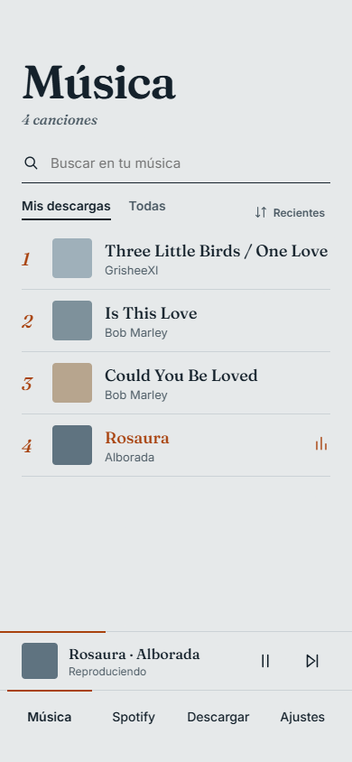
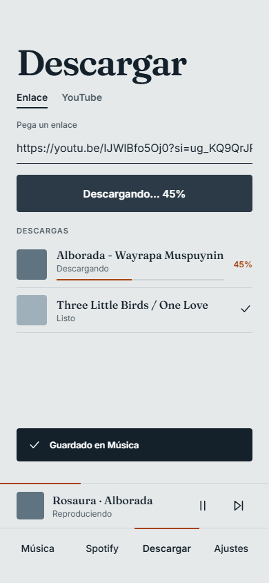
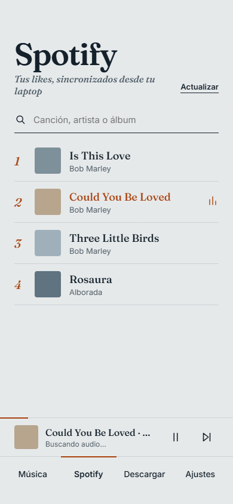
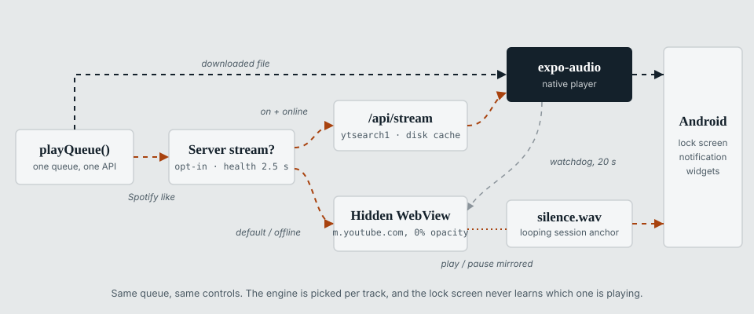
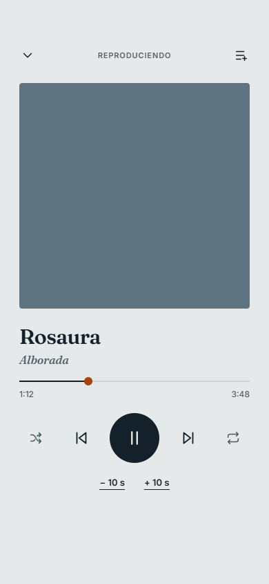
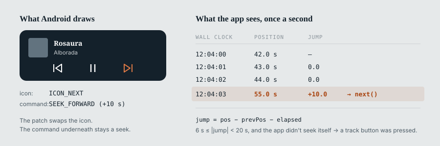
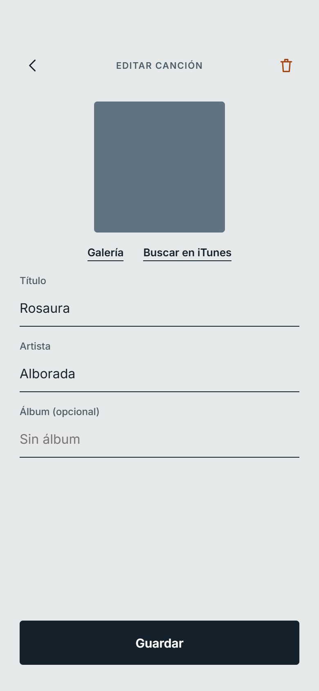

The [first MusicDown post](/blog/musicdown-android-mp3-downloader-expo/) ended with two pending
items: visual polish, and anything that worked in the background. Both got done, but they turned
out to be the smaller part of the work. Once I used the app daily, most of what needed fixing was
about **playback**: keeping a song going with the screen off, controlling it from the lock
screen, and getting a notification button to do what its icon says.

> **Same disclaimer as before:** a hobby project for my own private use. Not a product or a
> service, and not an invitation to ignore anyone's copyright or terms of service.

## What changed

| | July | November |
| --- | --- | --- |
| Tabs | Descargar · YouTube · Música · Ajustes | Música · Spotify · Descargar · Ajustes |
| Look | System fonts, emoji icons, white | Fraunces + Inter, Feather icons, one accent color |
| Player | Per-screen controls | One global player: mini bar, full screen, queue, shuffle, repeat |
| Spotify | — | Liked songs synced from my laptop, playable without downloading |
| Lock screen | — | Media notification with previous / play / next |
| Home screen | — | Seven widget variants |
| Extras | — | Synced lyrics, private downloads, share as `.mp3` |

## The redesign

This time I designed the screens before writing any code: one HTML file with every screen side by
side, then ported to React Native. The screenshots in this post come from that file; the app
matches it almost exactly.



The whole visual system fits in `theme.ts`:

```ts
// Blue-tinted paper, dark ink, and a single terracotta accent.
export const colors = {
  bg: '#E6E9EA',
  ink: '#14212B',
  muted: '#4A5963',
  line: '#CBD0D3',
  accent: '#A8420E',
};
```

**Fraunces** for titles, song names and track numbers; **Inter** for the rest of the UI. The
accent color has a single meaning, *currently playing*, and nothing else uses it. Songs without
cover art get a flat color from a five-tone palette, picked by hashing the song's id, so the same
song always looks the same.

"Descargar" and "YouTube" did the same job, so they're now one tab with an **Enlace / YouTube**
switch, a list of downloads with progress bars, and a toast when a file is saved.



## Spotify likes, without the Spotify API

I wanted my Spotify liked songs in MusicDown. The Web API isn't a good fit for a personal app,
because the developer who owns the app needs Premium to use it.

The desktop client already has my likes, though, and [Spicetify](https://spicetify.app/) lets me
run JavaScript inside it:

1. A Spicetify extension reads the liked songs using the desktop client's own session. No client
   ID, no OAuth, no Premium.
2. It `POST`s the list to my MusicDown server (`/api/spotify-likes`).
3. The phone `GET`s it from there.

Spicetify exposes Spotify's *internal* APIs, which change between client versions. So the
extension tries three strategies in order (internal GraphQL, the `LibraryAPI` object, and the Web
API through the client's session) and keeps the first one that works:

```js
for (const [name, strategy] of [['graphql', viaGraphQL], ['libraryapi', viaLibraryAPI], ['webapi', viaWebAPI]]) {
  try {
    return await strategy();
  } catch (e) {
    errors.push(`${name}: ${e.message}`); // try the next one
  }
}
```

It also listens for library `update` events, so a new like is synced three seconds later
(debounced), and it runs a silent sync whenever Spotify opens.



On the phone the list is cached for offline use. The first version stored it in AsyncStorage,
which on Android fails to read values larger than about 2 MB, so large libraries stopped loading.
The cache is now a JSON file in the app's document directory.

## One player, two engines

A liked song is just a title and an artist, so the app has to find the audio. I also wanted it to
behave like a downloaded song: same mini player, same queue, same lock-screen controls. A single
`BackgroundPlayerProvider` picks an engine per track:



**Downloaded files** play through `expo-audio`.

**Spotify likes** first check whether the server is up (2.5 s timeout). If it is, the app calls a
new endpoint, `/api/stream?q=artist title`. The server runs `yt-dlp "ytsearch1:artist title"`,
saves the audio to a disk cache keyed by a hash of the query (60 files max, oldest evicted first),
and serves it with `res.sendFile`, which handles range requests. Concurrent requests for the same
song share one download.

Before passing the URL to the native player, the app sends its own `Range: bytes=0-0` request
with a 70 s timeout. That makes the server finish downloading first, so the player gets an
immediate response instead of hitting its own, shorter timeout. If `expo-audio` still hasn't
loaded after 20 s, the track falls back to the second engine.

**The second engine** is a hidden WebView. It opens `m.youtube.com/results?search_query=…`, an
injected script picks the first real result (skipping promoted videos and Shorts), and the app
controls the `<video>` element through two globals, `__mdSetDesired('play' | 'pause')` and
`__mdSeek(seconds)`. Once per second the script reports position, duration and whether an ad is
playing, which is how the mini player can show *Anuncio*.

My first attempt hid the WebView with `width: 0` and `display: none`, and Chromium wouldn't play
anything. It now stays mounted at 360×640 with `opacity: 0`.



## Keeping the WebView playing with the screen off

Locking the phone stopped the WebView audio, for two separate reasons.

**YouTube's JavaScript** pauses playback when the Page Visibility API reports the page as hidden.
An injected script that runs before the page loads overrides that:

```js
Object.defineProperty(document, 'hidden', { get: () => false });
Object.defineProperty(document, 'visibilityState', { get: () => 'visible' });
window.addEventListener('visibilitychange', (e) => e.stopImmediatePropagation(), true);
```

The capture-phase listener on `window` runs before YouTube's listeners and stops the event. As a
fallback, if the video still pauses within three seconds of the page being hidden, the script
resumes it. After that it leaves playback alone, so it doesn't interfere with calls or other
audio apps.

**Android** also notifies the WebView when its window is no longer visible, and Chromium then
pauses any video with a picture. JavaScript can't reach that, so I patched
`react-native-webview` (applied through pnpm's `patchedDependencies`):

```java
@Override
protected void onWindowVisibilityChanged(int visibility) {
    super.onWindowVisibilityChanged(View.VISIBLE); // always visible, as far as Chromium knows
}
```

## A silent WAV for the lock screen

Android builds the lock-screen media card from a media session, and a WebView playing a
`<video>` doesn't get one.

The workaround: a second `expo-audio` player loops `assets/silence.wav` while the WebView engine
is active. That player owns the media session, so the notification shows the right title, artist
and cover. The audio mode is set to `mixWithOthers` so the silent track doesn't take audio focus
from the WebView. Both stay in sync: when one pauses, so does the other, and a pause from the lock
screen is forwarded to the WebView with `__mdSetDesired('pause')`.

## Buttons that lie

In this version, `expo-audio` lock-screen controls only offer **seek backward** and **seek
forward**. There's no previous or next track button.

First, I patched `expo-audio`'s Kotlin service so those two buttons show "previous" and "next"
icons. The underlying commands are unchanged: "next" still seeks forward ten seconds.

Then the app checks its own position on each status update and compares how far the song moved
with how much time passed. During normal playback those match. A jump of 6 to 20 seconds that the
app didn't trigger itself must have come from one of those buttons:



```ts
const elapsed = playing ? (now - prev.t) / 1000 : 0;
const jump = pos - prev.pos - elapsed;
if (Math.abs(jump) >= 6 && Math.abs(jump) < 20) {
  ignoreJumpUntil.current = now + 1500;
  jump > 0 ? next() : previous();
}
```

Every seek the app makes on purpose (the scrubber, the ±10 s buttons, loading a track) sets
`ignoreJumpUntil` first, so only external presses are translated. Since "previous" restarts the
song when it's past five seconds, the ten seconds it already rewound don't matter. With the
WebView engine, the jump is detected on the silent track, because that's the one the lock screen
controls.

## Home-screen widgets

MusicDown includes seven widget variants built with `react-native-android-widget`: 4×2 and 4×1
(each solid, semi-translucent or transparent) and 2×2, with Fraunces bundled for the titles.

Widgets run in a separate headless task, so the player publishes the current track to a small
bridge module that re-renders them and saves the state. After a cold start, the widget shows the
last song instead of an empty state. Cover art needed some care: a widget can't read `file://`
URIs, and its data goes through Android's Binder, which is limited to about 1 MB. The bridge
converts the cover to a base64 data URI, skips anything over 400 KB, and requests the 300 px
version of Spotify covers. It updates the widget immediately with the previous cover, then again
once the new one is ready.

## Smaller changes

- **Synced lyrics** from [LRCLIB](https://lrclib.net), a free API with no key. The query strips
  noise like `(Official Video)` or `feat.` from YouTube titles, tries splitting "Artist - Song",
  and prefers results with timestamps and a matching duration. Cancelled requests are never
  cached as "no lyrics".
- **Private downloads by default**: files go to the app's private storage with a `.zc3` extension
  and aren't added to the system media library. Sharing a song sends a temporary
  `Artist - Title.mp3` copy. A setting in Ajustes restores the old behavior.
- **Offline likes**: any liked song can be downloaded, individually or in bulk. A batch stops
  after three consecutive failures, which usually means the server is down.
- **Server status**: the app pings the server on launch and when returning to the foreground, and
  disables features that depend on it. Local playback never does. `npm run start:tunnel` runs the
  server behind a Cloudflare quick tunnel, so the phone also works away from my home network.
- **The edit screen** (ID3 tags and cover, from the gallery or the iTunes Search API) already
  existed in July; it just finally looks good enough for a screenshot.



## Where it's at

In July, the hard part was Android's storage permissions. This time it was media playback: media
sessions, window visibility, and notification buttons. Most of the fixes in this post work by
misleading one of those layers: a page that reports itself as visible, a silent file standing in
for the music, a seek button acting as "next".

One limitation remains. When a song falls back to the WebView engine, lock-screen controls only
take effect once the app is back in the foreground, because React Native doesn't deliver commands
to views while the app is paused. That's why the server path goes first.
